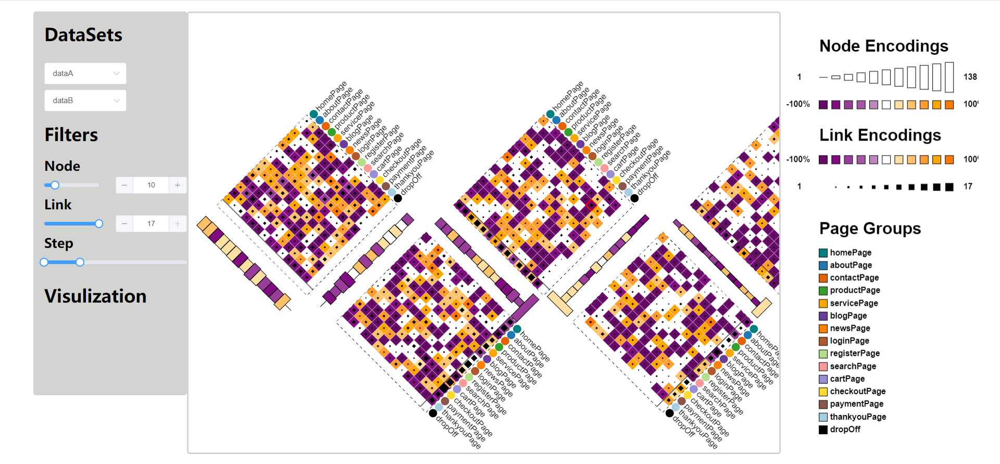

# matrixwave

A small Konva demo based on [MatrixWave: Visual Comparison of Event Sequence Data](https://doi.org/10.1145/2702123.2702419) (CHI 2015).



## Project setup

```
npm install
```

### Compiles and hot-reloads for development

```
npm run serve
```

### Compiles and minifies for production

```
npm run build
```

### Lints and fixes files

```
npm run lint
```

### Customize configuration

See [Configuration Reference](https://cli.vuejs.org/config/).
